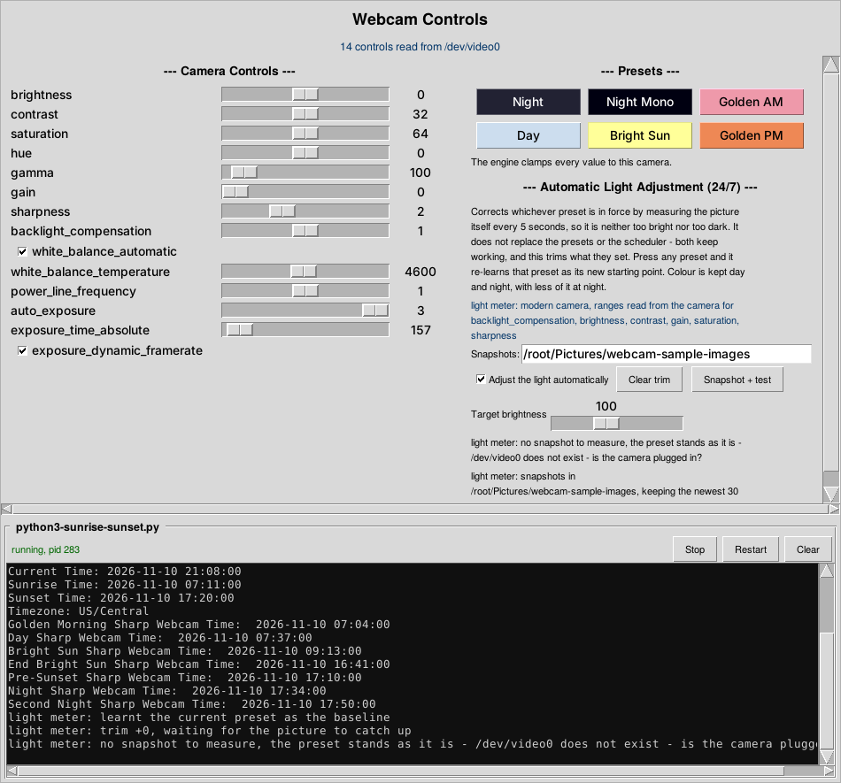
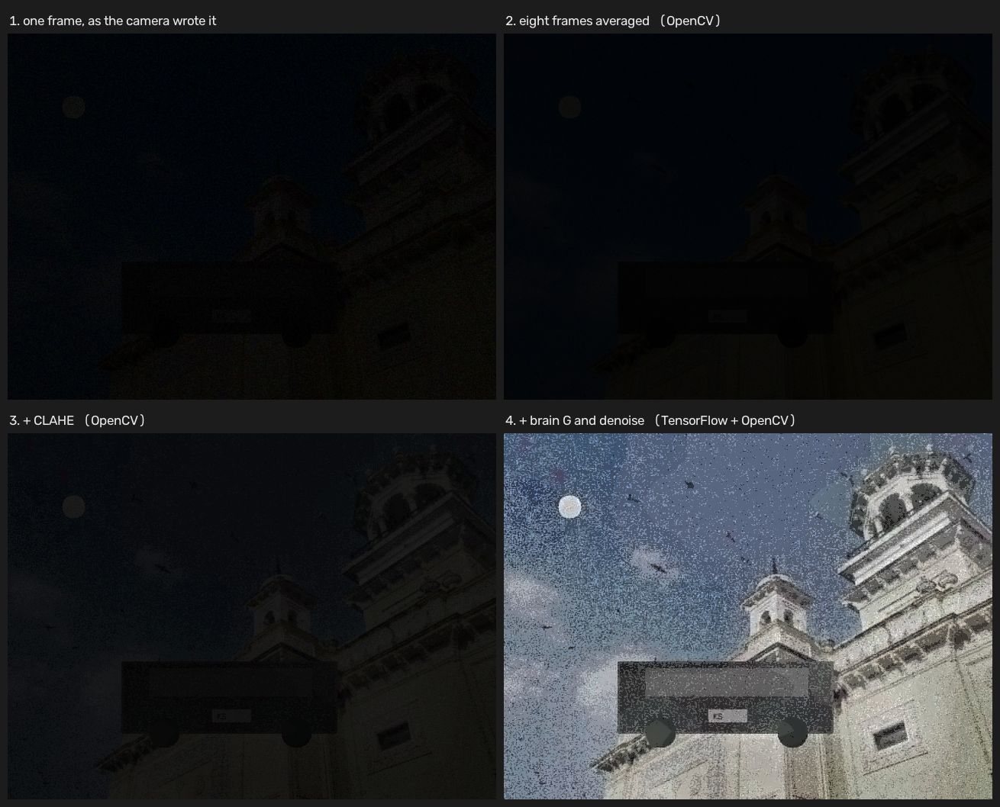
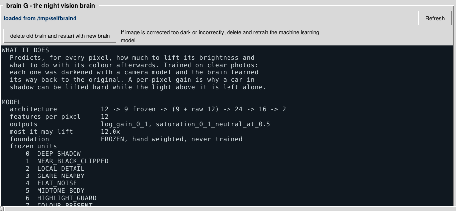
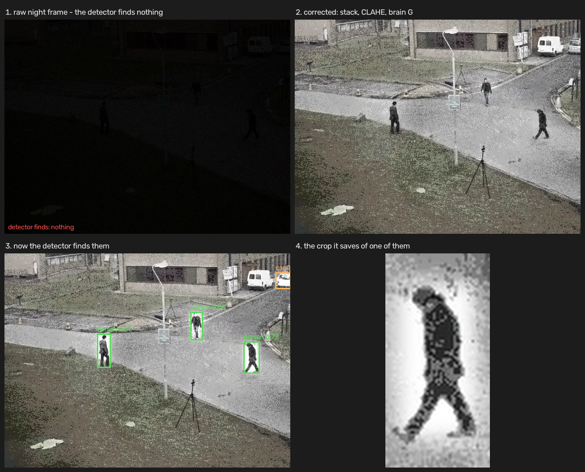
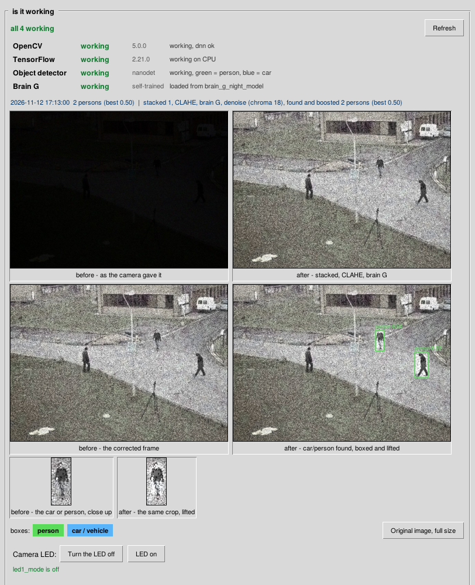

# Webcam Light Adjuster in Python 3

The Python 3 version of the webcam light adjuster, matching the Perl repository
(Perl-Outdoor-Webcam-Light-Adjuster) value for value.

Automatically adjusts an outdoor USB webcam's settings in Ubuntu Linux, 24.04
and 26.04: it
switches between tuned presets on today's real sunrise and sunset times, and
corrects whichever preset is in force by measuring the picture the camera is
actually producing. Written for a 1080p HD USB webcam, and it drives two
different control families, so it suits an older webcam and a current one.



The window is one tall page - camera controls and presets at the top, the
scheduler's terminal below them, and brain G's tile under that - scrolled by the
bar down the right hand side.

`webcam_GUI.py`: the camera's controls on the left with a scrollbar down the
right hand side, the presets and the automatic light adjustment on the right,
and `python3-sunrise-sunset.py` running in an 80 by 15 terminal along the
bottom, so the window shows what the schedule is doing and not only what has
been pressed in it.

*Taken on a machine with no camera attached: the control values are the
defaults rather than readings from a webcam, and the light meter reports that
it has no picture to measure. The scheduler in the terminal is really
running.*

## Start this before the recording software

**Run `python3-sunrise-sunset.py` first, then open Xeoma or whatever else records the camera.**

That order is what makes the snapshots work. A V4L2 camera lets one program
stream at a time, so the snapshot this program takes to measure the light can
only be grabbed while the camera is still free. Start it first and it takes one
every five seconds and corrects the light from them. Start the recorder first
and the grab is impossible - the status line then names the program holding the
camera, like `Xeoma (pid 2317) has /dev/video0`, and nothing is sent to the
device while it is in use.

The order stops mattering if the recording software writes its own stills into
the snapshot folder, since those are measured just the same. Either arrangement
works; one of them has to.

## Install

The programs check their own modules on the first run. Start one with a module
missing and it names the module and the apt package that provides it, shows the
command, and offers to run it:

```
webcam: these Python modules are needed and not installed:
  astral

This can install them now with:

    sudo apt-get -y install python3-astral

sudo will ask for your password.
Install them? [y/N]
```

Answer anything but yes and it exits having changed nothing. Once they are
installed it says nothing on any later run, and `sudo` is only ever invoked
when something is actually missing - an ordinary start never asks for a
password.

Under cron, systemd or a pipe it does not ask and does not install: there is no
terminal to answer on, and a prompt there would wait for an answer nobody can
give while the scheduler silently never started. It prints the command and
exits instead, so run it by hand once before putting any of this in a crontab.

It installs from apt and not pip, for the reason given below. The
check lives in `webcam_bootstrap.py`; `WEBCAM_NO_BOOTSTRAP=1` skips it, which
is what to use when the modules come from a virtual environment.

To install everything yourself first:

```
sudo apt-get -y install v4l-utils imagemagick ffmpeg curl python3-astral python3-tk
```

Keep all of the project files in the same folder.

`astral` is taken from apt rather than pip because Ubuntu 24.04 and 26.04
refuse `pip3 install` into the system Python - the error is
`externally-managed-environment`. If apt does not have it, either use a virtual
environment or pass `--break-system-packages`:

```
python3 -m venv ~/webcam-venv && ~/webcam-venv/bin/pip install astral
# or
pip3 install --break-system-packages astral
```

`imagemagick` measures the picture for the automatic light adjustment and
`ffmpeg` takes the snapshots. On Ubuntu 26.04 the `imagemagick` package
installs ImageMagick 7, whose command is `magick`; 24.04 and earlier install
version 6, whose command is `convert`. Either is accepted - the command name is
worked out at startup, because getting this wrong does not produce an error, it
just measures nothing.

`imagemagick` is what measures the picture for the automatic light adjustment.
Without it the schedule still runs; only the correction stays idle.

## Run

```
python3 python3-sunrise-sunset.py
```

Start this before the recording software - see above for why.

The scripts resolve each other next to the file being run, then in `$HOME`,
then in the working directory, so they work both from the repository and copied
into the home directory, and under cron either way. Each preset is run with the
same interpreter this scheduler is running under, rather than whatever
`python3` happens to mean, and its exit status is checked - a preset that
failed used to look exactly like one that worked, which mattered most for the
one preset nobody is awake to notice.

### The clock

Every light change here is worked out from the clock - the sunrise and sunset
offsets, the 04:46 refresh, which preset belongs to this minute. A computer
whose clock has drifted applies the night preset in daylight, and nobody
notices until the recording is useless.

So the real time is fetched at startup and once a day after that, and the
difference from this machine's clock is carried as an offset. Every decision
goes through that corrected time.

The source is the `Date` header of an HTTPS response - every web server sends
one, it needs no API key and cannot be rate limited away - from google.com,
then cloudflare.com, then timeapi.io as a third try.

**The system clock is not changed.** That needs root, and a camera program has
no business asking for it: Ubuntu already runs systemd-timesyncd, so if this
reports a large offset for days on end, `timedatectl status` is the thing to
look at rather than something for this program to override.

Being offline is not a failure - the fetch simply does not answer, the previous
offset stays, and everything carries on with the system clock as before. The
fetch is also how "are we connected" gets answered; a separate check that
passed while the time server was unreachable would tell us nothing useful.
The clock status is shown at startup, and an offset of ten seconds or more goes
to the error log.

### Where it thinks it is

Sunrise and sunset depend on where you are, and there is no place written down
anywhere in these programs. The location is worked out at startup, first answer
wins:

1. `WEBCAM_LAT` and `WEBCAM_LON`, for a machine that should not be guessing -
   a camera on a tower a county away from the computer driving it, say.
2. The cached answer in `~/.webcam-location.conf`, if it is less than a week
   old. Nothing goes out to the network on an ordinary run.
3. An IP lookup, which gives the city the connection comes out of.
4. The last cached answer whatever its age, since a stale location beats none -
   sunrise moves by about a minute a day, not an hour.

Worth being plain about the lookup: it tells a third party (ipinfo.io, and
ip-api.com if that one is not answering) this machine's IP address, and what
comes back is where the internet connection surfaces, not where the camera is.
On a VPN it is wrong by however far the VPN reaches. That is why the answer is
cached, shown, and overridable:

```
export WEBCAM_LAT=41.2619
export WEBCAM_LON=-95.8608
export WEBCAM_TZ=America/Chicago      # optional; the system's zone otherwise
```

Set those and no IP lookup is ever made. Accuracy only has to be rough: a
tenth of a degree of latitude moves sunrise by well under a minute, and these
presets switch on offsets of 7 to 122 minutes, so a city-level answer is as
good as a surveyed one.

**The time zone comes from the coordinates**, not from the system clock. The
two are different things: the system zone is whatever this computer was set up
with, and a camera reporting to a machine in another state, or a laptop carried
across a zone line, would have its sun times worked out for the wrong one. The
coordinates are where the camera is, so the zone belonging to those coordinates
is the right answer - looked up once and cached beside them, from the system's
own zone only if both services are unreachable. `WEBCAM_TZ` overrides it.

The settings file is written on the first successful lookup and again whenever
the sunrise and sunset times are fetched over the internet, so the place those
times were worked out for is what stays saved:

```
$ cat ~/.webcam-location.conf
lat=41.2619
lon=-95.8608
tz=America/Chicago
source=confirmed by the sun-times fetch
saved=2026-11-10 11:13
```

Delete that file to make it look the location up again.

## The control window

```
python3 webcam_GUI.py
```

A window with the same presets, the same engine and the same automatic light
adjustment as the scheduler. Both can run at once: neither opens the video
stream, they only set controls, and each re-reads the other's work rather than
fighting over it - press a preset here and the light meter notices within five
seconds and re-learns it as its baseline.

It builds itself from the camera. Every control on the window comes from
`v4l2-ctl -L` at startup, with the range the camera reported, which is the only
way one window serves both the older webcam on 0-255 ranges and the current
ones where brightness runs -64 to 64. Integer and menu controls get a slider
over the camera's own range, booleans get a checkbox, and a control the camera
has that this program has never heard of still appears rather than being
quietly dropped. Nothing is sent that the camera did not confirm it has.

The window scrolls - a camera with every control the kernel defines makes a
taller column than most screens have room for - with a scrollbar on the right,
one along the bottom, the wheel, Page Up and Page Down, Home and End.

There is no preview, deliberately: a V4L2 camera lets one program stream at a
time and the recording software has it. Judge the picture in whatever is
recording it.

It needs `python3-tk`, which is in the install line above.

## The schedule

Presets switch on offsets from today's real sunrise and sunset:

| Time          | Preset         |
|---------------|----------------|
| sunrise − 7   | golden morning |
| sunrise + 26  | day            |
| sunrise + 122 | bright sun     |
| sunset − 39   | day again      |
| sunset − 10   | golden evening |
| sunset + 14   | night          |
| sunset + 30   | night again    |

Night is applied twice because a camera does not always take the settings on
the first attempt. Edit the minute offsets in `python3-sunrise-sunset.py`.

Today's times are refreshed at 04:46, which is before the earliest sunrise of
the year, so the new times are always in place before the morning's first
change. The lookup tries the internet first, then the times saved in
`~/.webcam-sun-times.conf`, then a local calculation; if all three fail,
yesterday's times stay in use rather than being wiped.

## Camera settings engine

The per-preset scripts hold no numbers of their own. They all call
`webcam_presets.py`, which reads the control list from whichever camera is
plugged in and picks the matching values:

* The older webcam uses the pre-5.10 kernel control names (`exposure_auto`,
  `exposure_absolute`, `focus_auto`) on 0-255 ranges.
* The Walmart ONN webcam uses the current names (`auto_exposure`,
  `exposure_time_absolute`) on much smaller ranges.

The same number means a different brightness on each, so the engine keeps one
value table per family, clamps every value to the range the camera reports, and
skips controls a camera does not have. It prints `(asked 175, clamped)` when it
has to clamp.

Run a preset directly:

```
python3 webcam_presets.py night
python3 webcam_presets.py night-mono
python3 webcam_presets.py golden-am
python3 webcam_presets.py day
python3 webcam_presets.py bright-sun
python3 webcam_presets.py golden-pm
```

Set `WEBCAM_DEVICE`, or pass a second argument, for a camera other than
`/dev/video0`. The wrapper scripts - `night-sharp-webcam.py` and the rest - are
kept so existing habits and the scheduler keep working; each is the same as one
`webcam_presets.py` call.

## Night tuning and white balance

Night brightness comes from a long exposure rather than the brightness control,
which saturates. The night preset asks for a long exposure, reads it back, and
steps down until the driver accepts one, because the driver silently clamps any
exposure that will not fit inside the current frame interval.

Night was retuned to match the ONN settings, mapped onto the older camera's
0-255 ranges rather than copied as raw numbers: brightness and gain to the top,
the longest exposure the driver will take, backlight compensation on, and
sharpness cut back from 250 to 109.

`night-mono-sharp-webcam.py` is the same thing without colour. Colour noise is
most of what makes a dark frame look muddy, so dropping saturation to 0 trades
colour for a cleaner, apparently brighter picture.

Every preset that asks for it uses a cold white balance of 2800. Note that
`white_balance_temperature` sets the colour temperature the camera **assumes**
the light to be, not the look of the picture: a low value tells the camera the
light is warm, so it compensates with blue and the result looks cold. Change
`COLD_WB` at the top of `webcam_presets.py` to adjust it. Day, golden morning
and golden evening use automatic white balance instead - the evening light
swings from white through orange to dusk inside the hour that preset covers, so
no single temperature is right for more than a few minutes of it.

## Automatic light adjustment (24/7)

The schedule above still picks the preset. On top of it, the scheduler measures
the picture the camera is actually producing, every 5 seconds, and corrects
whatever the preset set so the result is neither too bright nor too dark. A
cloudy afternoon, a security light coming on at 2am, snow glare at noon - none
of that is on a clock, so none of it can be handled by one.

It is a correction and not a replacement. Every preset stays exactly as it is,
including its white balance, focus and exposure mode. The correction moves five
light controls away from the preset's own values by a trim of −5 to +5 steps:

* **gain** carries most of it, being the control that actually amplifies signal
* **brightness** moves least, since on these webcams it is a black level lift
  rather than exposure
* **contrast** rises with the trim to keep the range spread out
* **saturation** comes *down* as the trim goes up, so there is colour day and
  night, with less of it at night where most of what is left is noise
* **backlight compensation** rises with the trim

When a preset fires, or a control is moved by hand, the loop notices the
settings are not what it last wrote and re-learns them as its new baseline,
with the trim back at zero. Nothing has to tell it a preset ran. The comparison
allows two units of slack, because a driver may round a value to its own step
size - without it, a value that came back as 99 after 100 was sent would look
like an outside change, the baseline would be re-learnt with the trim already
inside it, and the next correction would trim again from there: a ratchet that
walks the picture off in one direction.

### What it measures

Average grey level, plus two clipping figures: how much of the frame has gone
to pure white and how much to pure black. The mean cannot see either problem on
its own - a frame that is half blown-out floodlight and half pitch black
averages to a respectable middle grey while showing nothing at all. Either
figure can override the mean; the limits are 2% blown white and 30% crushed
black, against a target grey level of 100 of 255. When both are out at once,
which is what a security light over black tarmac looks like, it holds where it
is and says so, rather than chasing a picture the sensor cannot hold.

It takes the median of three samples, needs two consecutive samples to agree
before it moves, and waits two samples after each change, so passing headlights
do not drag the picture dark for the next minute.

A status line goes to the terminal as it works:

```
light meter: trim +2, mean 91 of target 100, white 0.0%, black 14% - picture is where it should be
```

The loop itself lives in `webcam_light_meter.py`, and is imported
defensively: if that module or ImageMagick is missing, the scheduler starts and
runs the clock-driven presets exactly as before. The schedule's 20-second wait
is handed to the meter so the picture is sampled four times during it, instead
of the scheduler sitting blind for the whole 20.

### Sharpness

Sharpness is set outright rather than trimmed, and it overrides whatever the
preset asked for: full sharpness in daylight and through the golden hours,
eased to 80-90% of the control's range at night.

What decides night from day is gain rather than the clock. Gain is the only
control that amplifies sensor noise along with the signal, so a camera near the
top of its gain range is working in the dark whatever the time - and the golden
hour presets, which sit under half the gain range, come out at full sharpness.
Sharpening is contrast enhancement at the pixel level and it sharpens noise as
happily as it sharpens the edge of a number plate, which is the only reason to
ease off at all.

If no snapshots appear in the folder, the status line now says why rather than
guessing. The reasons it can give:

| Message | What to do |
|---------|------------|
| `<program> (pid N) has /dev/video0` | That program has the camera. Start this one before it to take snapshots here, or have it write stills into the folder. |
| `no permission to open /dev/video0` | `sudo usermod -aG video $USER`, then log out and back in. |
| `/dev/video0 does not exist` | The camera is unplugged, or it is on another node - check `v4l2-ctl --list-devices`. |
| `ffmpeg is not installed` | `sudo apt install ffmpeg`. |
| `ffmpeg could not take a snapshot: ...` | ffmpeg's own words for anything else. |

To see the whole error yourself:

```
ffmpeg -nostdin -f v4l2 -i /dev/video0 -frames:v 1 -y /tmp/test.jpg
```

A busy camera is retried on every pass rather than written off for the session,
so if the recording software lets go of the device the snapshots start on their
own.

### The error log

Everything that goes wrong is written to `~/.webcam-light-meter.log` with a
timestamp, so a failure at three in the morning can be read back in the
morning - the status lines only ever show the latest thing. Set `WEBCAM_LOG`
to put it somewhere else.

```
tail -f ~/.webcam-light-meter.log
```

Logged: the startup probe and what it found, the snapshot folder, every
snapshot failure with ffmpeg's own words, every trim applied and what the
measurement was, every time a preset is re-learnt as the baseline, and anything
that stops the loop working. Not logged: the routine pass where the picture is
already where it should be, which would be twelve lines a minute and would bury
everything worth reading.

Repeats are collapsed - a busy camera says so every five seconds, and an error
identical to the last one is written again only after ten minutes. The file is
trimmed to its newest 500 lines once it passes a megabyte, so it cannot grow
without end.

### Focus

Continuous autofocus is on at all times, and nothing in these programs ever
leaves the camera in manual focus. Every preset ends by switching autofocus off
and straight back on, and so does every correction the light meter makes.

That toggle is the point of it. Changing gain, brightness or contrast changes
what the autofocus is looking at, and the camera does not always re-run its
search on its own - so the first seconds after a light change come out soft and
out of focus, which on a recording is exactly the part you want sharp. Setting
the control to 1 when it is already 1 does nothing; turning it off and back on
starts a fresh search. There is a third of a second between the two writes,
because the driver has to see the control actually change state - land both in
the same instant and nothing is re-triggered.

The preset tables used to carry a fixed focus distance, applied with autofocus
off. That column is gone and `focus_absolute` is no longer set.

### Control ranges

At startup the camera is asked what its controls can actually do
(`v4l2-ctl -L`) and those ranges are what get used, because a trim step is a
fraction of a control's range: assume 0-64 for a contrast control that really
runs 0-95 and every correction lands a third short. Anything the camera does
not answer for falls back to the ranges these programs were already using - the
ONN set for a modern camera, the 0-255 set for the older one - so an unanswered
control still gets a sensible step instead of being dropped. A line at startup
says which ranges came from the camera and which were assumed:

```
light meter: modern camera, ranges read from the camera for backlight_compensation, brightness, contrast, gain, saturation, sharpness
```

### Setting up the snapshot

The camera cannot be opened for this: V4L2 allows only one program to stream,
and the recording software holds the device. So the still comes from that
software instead. Set `WEBCAM_SNAPSHOT` to one of:

* a **directory** - the newest `.jpg` in it is measured, which is what a "save
  snapshots to folder" module produces; anything older than ten minutes is
  ignored
* a **single file** - for software that overwrites the same still each time
* an **`http://` URL** - a snapshot URL from the recording software's web server

```
sudo apt install imagemagick
export WEBCAM_SNAPSHOT=$HOME/webcam-snapshots
export WEBCAM_TARGET=100        # target grey level out of 255, optional
export WEBCAM_DEVICE=/dev/video0
```

The default folder is `~/Pictures/webcam-sample-images` under
whoever's home directory the program is running as - no user name is written
into any of this. `$HOME` is used when it is set, and the password database
when it is not, which is the case under some cron and systemd setups.

The folder used to be
`~/Pictures/onn-webcam/program-snapshots-for-auto-adjust-picture`, and that
one is still looked in if it exists, so an installation that has been filling
it for months is not left with nothing to measure.

**Taking the snapshots.** That one folder is created at startup if it is not
already there, parent folders and all. Nothing else is ever created.
If the recording software is writing stills into it, those are what get
measured. If it is not - an empty folder on the first run - a frame is grabbed
here instead with ffmpeg. That only works while the camera is free: a V4L2
camera lets one program stream at a time, so if the recording software has the
device the grab fails with a busy error, reported once rather than every five
seconds all night.

**Which program opens the camera first decides this.** A V4L2 camera lets one
program stream at a time, so:

* Start this program **before** the recording software and the snapshots are
  taken here, every five seconds, for as long as the camera stays free.
* Once the recording software opens the camera, the grab stops - and the
  status line names the process holding it, something like
  `Xeoma (pid 2317) has /dev/video0`. Nothing is sent to the device while
  another program has it: retrying would achieve nothing, and if the recorder
  dropped and re-opened its stream at the instant a grab landed, the grab
  would win and the recorder would fail to come back. The check is repeated
  once a minute rather than every five seconds.
* While the recorder has the camera, the folder is still read - so stills that
  the recording software writes there are measured exactly as before, and the
  light keeps being corrected.

The practical arrangement is either one: let this program take the snapshots
by starting it first, or have the recording software write stills into that
folder and start it whenever you like.

**Only the last 30 are kept.** Each new snapshot prunes the folder back to the
newest 30, oldest deleted first, and the same happens once at startup. Every
`.jpg` in the folder counts, whoever wrote it.

With no snapshot available, nothing is corrected and the presets stand as they
always did.

## Night image correction: stacking, CLAHE and brain G



This is the part of the picture that no camera control can reach, and it is
switched on with the two boxes in the window:

* **night image CLAHE and ML auto correct** - runs it once the gain is past
  half its range, which is the same test the sharpness uses for night. A
  floodlit yard at midnight does not get it; an overcast dusk does.
* **24 hour image CLAHE and ML auto correct** - runs it on every still around
  the clock, and overrides the first box.

Both are written to `~/.webcam-enhance.conf`, so a box ticked in the window is
picked up by the scheduler on its next pass, including when the scheduler is
the only thing running under cron.

**It works on the snapshots in the picture folder, not on the camera.** The
recording software holds the camera and owns the video; this reads the stills
that are already in the folder and writes corrected copies into an `enhanced`
subfolder beside them. Nothing it does changes what gets recorded - the presets
and the light meter remain the only things that affect that. What it gives is a
far more readable set of stills of the same scene.

Three things happen, in this order, because each makes the next work better:

1. **Frame averaging.** The stills are consecutive frames of the same scene, so
   averaging the newest few cancels sensor noise while leaving the scene alone.
   This is the only one of the three that adds real information, and it is the
   one to trust. Measured on held-back photos, going from one frame to eight is
   worth **+2.49 dB and +0.27 SSIM** - more than CLAHE and the correct put
   together.
2. **CLAHE.** Contrast-limited adaptive histogram equalization, per tile, so a
   security light in one corner does not set the scale for the whole frame.
   Real CLAHE needs ImageMagick 7 (Ubuntu 26.04) or OpenCV; on ImageMagick 6
   a global contrast stretch stands in and the status line says so.
3. **Brain G**, the night vision brain - see below.

### Brain G

A trained model, built in the same shape as the trading robot's brains: a
**frozen hand-weighted foundation** of nine named detector units with a small
trainable head on top, a 20,000 sample pretrain, a `meta.json` beside the
model, and a stale-model check that retrains rather than quietly running a
model that no longer matches the code.

```
12 features -> 9 FROZEN detectors -> (those 9 + the raw 12) -> 24 -> 16 -> 2
```

The nine frozen units: `DEEP_SHADOW`, `NEAR_BLACK_CLIPPED`, `LOCAL_DETAIL`,
`GLARE_NEARBY`, `FLAT_NOISE`, `MIDTONE_BODY`, `HIGHLIGHT_GUARD`,
`COLOUR_PRESENT`, `GLOBAL_DARK_SCENE`.

**It is trained on clear photos.** Each clear photo is darkened with a camera
model - lost exposure, Poisson shot noise, read noise, a softened lens, a
colour cast, JPEG, and some of them averaged in stacks the way they are at run
time - and the brain learns, for every pixel, how much that pixel has to be
lifted to get back to the clear original. The clear photo is the answer sheet.

Two numbers come out per pixel: a brightness gain and a colour correction to go
with it. Per-pixel is the whole point - a single exposure setting cannot lift a
car in deep shadow *and* leave the security light above it alone, and a
per-pixel gain can.

Measured on photos held back from training whole (not by pixel), eight degraded
frames of each through the real pipeline, against the clear original:

| stage | PSNR dB | SSIM |
|-------|--------:|-----:|
| one dark frame | 5.68 | 0.080 |
| stacked + CLAHE | 6.86 | 0.229 |
| + analytic correct | 12.83 | 0.535 |
| + brain G | **16.64** | **0.727** |

So the brain is worth **+3.81 dB** on the analytic correct, which is what runs
when there is no brain to load. The window's brain tile shows these numbers,
and the score a flat "lift everything the same amount" answer got, which is the
only honest way to read the rest.

Keeping the foundation frozen was not just house style - it was measured. The
frozen detectors plus the raw feature path beat an unconstrained net several
times the size, so the hand-weighted units are adding information rather than
only constraining the fit.

**What it cannot do.** The brain is making an informed guess: it was trained to
produce what a clear photograph of the scene would have looked like, so it will
confidently fill in what it expects to be there. It is a good way to see
whether a vehicle is present and roughly what it is doing. **It is not
evidence** - a number plate the sensor never captured can come back looking
sharp and being wrong.

### It trains itself on your camera, and deletes the brain that shipped here

The brain in this repository was trained on general photographs. Yours will not
keep it for long.

Every pass of the light meter files the still it just measured into a training
set at `~/Pictures/webcam-brain-corpus/`, tagged with the preset in force and
how hard the camera was working. A preset or light change files one
immediately, which is the point: over a day and a night the set fills up with
frames from every preset and every light level this camera actually sees. Once
there is a real spread of them it trains a new brain on them, scores it against
the shipped brain **on held-back frames from your own camera**, and if the new
one wins it deletes the shipped brain and never uses it again. After that it
retrains once a day, so it keeps up with the seasons and with the camera being
moved.

In testing, the brain trained on a camera's own frames scored **17.55 dB
against the shipped brain's 13.76 dB on the same held-back frames** - which is
the whole argument for doing this.

**The one rule that cannot be bent:** only a well-exposed frame can be a
training target. Training has to know what the right answer looks like, and a
noisy black frame does not contain it - train with dark frames as the target
and the brain learns to produce dark frames. So what gets banked as an answer
sheet is always a frame the camera managed to expose: daylight, dusk, a
floodlit yard.

What the light changes add, and it is the valuable part, is **real pairs**. The
camera is bolted down, so a dark frame and a well-exposed frame of the same
scene a minute apart are a genuine training pair from this sensor - a real
input with a real answer, no camera model guessed at in between. That happens
at dusk and dawn and when a light comes on. At three in the morning it does
not: no preset change makes a pitch-dark yard well exposed, so there is no
answer to learn from and nothing is banked. Expect real pairs to be a handful,
not hundreds, and expect the clear daytime frames to do the heavy lifting.

Nothing is thrown away before its replacement exists. If the new brain scores
worse than the shipped one, the shipped one is **kept** and the window says so;
the camera-trained brain is still what gets used, but it will retrain tomorrow
with more frames behind it.

### When the correction looks wrong



There is a button in the brain tile:

> **delete old brain and restart with new brain**
>
> If image is corrected too dark or incorrectly, delete and retrain the machine
> learning model.

That is the fix when the corrected stills come out too dark, washed out, or the
colour has gone strange - a trained model can go wrong in ways no score catches,
and when it does, the brain is what did it. The button deletes the brain and
trains a fresh one from everything harvested since. It runs in the background,
so the window keeps working while it does.

The harvested frames are never deleted by it. They are the valuable half: a
brain can be rebuilt from them in a minute, and the frames cannot be got back
without waiting another day.

### Which library does what

Both are used, for different halves of the job:

| | does |
|---|---|
| **OpenCV** | the foundational processing - decoding the stills, averaging the stack, the LAB conversion and the CLAHE, the box blurs behind the twelve feature planes, the resizing, the denoise. Fixed, rule-based, fast, none of it learnt. |
| **TensorFlow** | the one part that is learnt - running brain G over those features, and training it. |

Brain G needs both, because the features are OpenCV's work and the brain cannot
see without them. TensorFlow with no OpenCV falls back to the analytic correct
rather than half-running a brain.

| | |
|---|---|
| nothing | the analytic correct and a contrast stretch, through ImageMagick |
| ImageMagick 7 | real CLAHE |
| OpenCV (`pip install opencv-python`) | the foundational half: faster, and true per-tile CLAHE |
| TensorFlow (`pip install tensorflow-cpu`) | the learnt half: brain G, and retraining it on your camera |

Any piece that is missing is named in the brain tile and in the status line,
and the next tier down does the work instead.

## Finding cars and people



(That figure was made before the box colours were fixed: the vehicle box in it
is orange, where the current code draws it blue. The colour tuple was in RGB
order and OpenCV wanted BGR. Person boxes were green then and are green now.)

The third box, **find cars and people and enhance them**, runs an object
detector over the corrected still, and then gives whatever it found a second,
stronger lift of its own - a gain and a CLAHE run on that region alone, feathered
at the edges so it does not show up as a bright rectangle drawn on the picture.
A close crop of each thing found is written to a `detections` folder, which is
what you actually want to look at in the morning: the car, rather than the yard
with the car in the corner of it.

**The order is the whole trick.** Detection runs *after* the correction, not
before. A detector looking at a raw night frame sees an almost uniform black
rectangle and finds nothing in it, because there is no contrast for it to work
with. The same detector on the frame after stacking, CLAHE and brain G has
something to see. Measured on the same night frame:

| | what the detector finds |
|---|---|
| the raw night frame | **nothing at all** |
| after the correction | **1 car, 3 people** (best confidence 0.73) |

The detector is NanoDet-Plus-m from the OpenCV Model Zoo, run through
`cv2.dnn` - a real detector trained on COCO, not a shape heuristic. It returns a
class and a confidence. Of its eighty classes these scripts use six: **person,
bicycle, car, motorcycle, bus, truck**. It is a 3.8 MB file in `detector/`,
Apache 2.0, licence included beside it, and it needs no GPU and no network.
Nothing here runs code from it - it is weights, and the decoding of its output
is written out in `webcam_detect.py`.

Two honest limits:

* It works on what is actually visible. A car across a lit or part-lit yard is a
  reasonable target; the same car on a moonless night with no light at all is
  not, because the correction can only amplify what the sensor recorded. When it
  finds nothing you get the ordinary whole-frame correction, which is what you
  would have had anyway.
* A detection is the detector's opinion about a picture that is itself partly
  guessed. Read a box as "something that looks like a car is probably there",
  not as proof of one.

You can run it by hand on any still:

```bash
python3 webcam_detect.py some-snapshot.jpg --save
```


## Is it working: the status tile, and the four-frame comparison

The correction is a stack of things that each fail quietly: OpenCV does the
stacking, the CLAHE, the denoise and the detector, TensorFlow runs brain G,
and when either is half-installed the picture still comes out - just
uncorrected, and with nothing anywhere saying so. A mixed conda and pip
OpenCV is the usual way in, and it imports perfectly and then throws on the
first `createCLAHE`.

So the bottom of the window, under brain G's tile, answers the question
directly. Four rows, each re-checked by the refresh button:

| Row | What it means |
|-----|---------------|
| OpenCV | imported, **and** a CLAHE and a colour convert actually ran |
| TensorFlow | imported, **and** a tensor add came back with the right answer, on CPU or GPU |
| Object detector | the NanoDet `.onnx` is present and the net loaded |
| Brain G | a brain is loaded, and whether it is self-trained or the shipped one |

Each row is green when working and red when not, with the version, and a
failed row prints what to try - for the mixed-install case, that it is a
conda and a pip OpenCV and one of them has to go.

Nothing here reports "installed". Installed is not the question; every row is
a small piece of real work, run on the spot.



### The four frames

Under the rows, the frames themselves - two wide and three tall, at the width
of the terminal above them:

```
  before - as the camera gave it      after - stacked, CLAHE, brain G
  before - the corrected frame        after - car/person found, boxed, lifted
  before - the car or person close up after - the same crop, lifted
```

The top row is the correction. The middle row is the enhancement that runs on
top of it, and its right-hand frame carries the boxes: **green for a person,
blue for a car or other vehicle**, each with what the detector called it and
how sure it was.

The bottom row is the one that matters most. It is the highest-scoring thing
the detector found, cut out of both frames at the same place with a margin
around it, so the question stops being "did the correction run" and becomes
"can the number plate be read". Both crops come from the same rectangle, so
they sit square above one another and can be compared by eye. Nothing found
means that row stays as it was rather than going black - a quiet night is not
a failure.

The line above the pictures says what the pass did and what it found.

### When they refresh

The file times of the six frames are checked **every 3 seconds**, which is six
stat calls and nothing else, so a new set is on the screen within a few
seconds of being written rather than waiting out a fixed interval. **Every 30
seconds** they are reloaded anyway, whatever the times say - which covers a
clock that went backwards over a daylight saving change, and a frame written
twice inside the same second.

A picture-only refresh does not re-run the library checks. Importing
TensorFlow takes several seconds and the libraries cannot have changed since
the last picture, so re-checking them every few minutes all night would be
seconds of work to confirm something that did not move. The Refresh button
runs the full check.

The order is the point. The detector runs last, on the corrected frame,
because a detector looking at the raw night frame sees a black rectangle and
finds nothing in it - measured on one night frame here, nothing at all before
the correction and three people and two vehicles after it. The bottom row is
where that shows.

The boxes are drawn on this copy and on nothing else. The corrected still
that gets kept has none on it, deliberately: a rectangle drawn across a
number plate is worse than no rectangle, and these four exist to be looked at
rather than to be evidence.

The frames are written by the correction itself into `compare/` beside the
enhanced stills, as ordinary JPEGs, and scaled into PPM thumbnails for the
window. PPM because it is the one format both Python's tkinter and Perl's Tk
read with no extra module - these programs install their own dependencies and
asking for Tk::PNG or Pillow on top is one more thing to fail at three in the
morning.

## Every error, in full, in a terminal of its own

Everything in the correction path is written so a failure costs the picture
rather than the program: a CLAHE that throws leaves the frame uncorrected and
the scheduler carries on. That is right at three in the morning and it used
to mean the failure was invisible.

Now every one of those handlers writes first. The pane under the comparison
frames is a terminal tailing that log, verbose, with the full traceback:

```
[2026-11-12 03:14:07] OpenCV FAILED: cv2.error: OpenCV(5.0.0) ...
    while: CLAHE on the stack of 8
    Traceback (most recent call last):
      ...
    try: a mixed conda and pip opencv - keep one of them
```

Stages are tagged and coloured, so `OpenCV`, `TensorFlow`, `brain G`,
`detector` and `night correction` can be told apart at a glance and grepped
apart in the file. The same exception repeating every pass is written once a
minute rather than forty times an hour. The log is `~/Pictures/webcam/`,
rolled by size, with a clear button in the tile.

Notes go in too, not only failures - what the correction decided, how far
brain G lifted the frame - so the pane shows the run rather than only its
worst moments.

## It installs its own dependencies, out loud

Every program checks and installs what it needs on startup, and says what it
is doing while it does it, step by step:

```
Checking what the webcam programs need.
  python   3.12.7 at /home/david/anaconda3/bin/python3
  this is  conda (base)

[1/8] numpy        present   2.1.3
[2/8] tkinter      present
[3/8] astral       MISSING   ModuleNotFoundError: No module named 'astral'
          needed for: sunrise and sunset times for the schedule
[4/8] cv2          present   5.0.0
[5/8] tensorflow   MISSING   ModuleNotFoundError: No module named 'tensorflow'
          needed for: brain G, the learnt night correction

2 thing(s) to install:
  astral         via conda  conda install -y -c conda-forge astral
  tensorflow     via pip    python3 -m pip install --upgrade tensorflow

[1/2] installing astral with conda
    $ conda install -y -c conda-forge astral
    | Collecting package metadata (repodata.json): done
    | Solving environment: done
    | Preparing transaction: done
    finished with exit code 0
    import astral: works
```

Every line of the installer's own output is streamed as it arrives rather
than held back to the end, each step ends with its exit code, and each
installed module is imported afterwards to confirm it actually took.

Where it installs from is chosen, not guessed. **In a conda python, OpenCV
comes from conda-forge** - `conda install -c conda-forge opencv` - because
installing the pip OpenCV on top of the conda one is the mixed install that
breaks the CLAHE, and this is the place that prevents it. Otherwise pip, and
apt for what pip has no answer for (`python3-tk`, `v4l-utils`, `ffmpeg`,
`imagemagick`).

It asks before installing when there is a terminal to ask on. With no
terminal - started from cron, or from a desktop launcher - it prints the plan
and installs nothing, unless `WEBCAM_AUTO_INSTALL=1` says to go ahead
unattended. `WEBCAM_NO_BOOTSTRAP=1` skips the check entirely.

## Turning the webcam's LED off

Two buttons under the presets - **Turn the LED off** and **LED on** - with a
line underneath saying what the camera actually did.

Most webcams will not allow it. The privacy light is frequently wired to the
sensor's own power rail, and on those cameras nothing in software can touch
it: it comes on when the camera streams and that is the end of it. A few
expose it as a UVC control called `led1_mode`, where 0 is off, 1 on, 2 blink
and 3 auto.

So the button does not report what it asked for. It sets the control, reads
it back, and tells you what the camera says now:

```
led1_mode is now off                       it worked
this camera does not expose its LED -      there is no such control, and
  on most webcams the light is wired         no amount of trying will make
  to the sensor and no software can          one appear
  turn it off
led1_mode was set to off but the camera    the control is there and the
  reports on - it is ignoring the            firmware is ignoring it
  setting, which some firmware does
led1_mode has no usable values             the kernel bug below
  (min=4 max=4)
```

A camera with no LED control keeps its buttons, greyed out, rather than
losing them - so the row still answers "can I?" next time rather than looking
like a feature that was never built.

Two things worth knowing. There is a kernel regression - 6.1 to 6.3 and after,
on some cameras - where `led1_mode` appears with `min=4 max=4` and no working
values; that is named rather than reported as a camera that ignores you,
because from the outside the two look identical. And where the driver never
mapped the control at all, `uvcdynctrl -s 'LED1 Mode' 0` is tried as a
fallback, if it is installed.

To see for yourself what your camera offers:

```
v4l2-ctl -d /dev/video0 -L | grep -i led
python3 webcam_led.py --status
```

Nothing in that output means nothing to be done - and that is the answer for
most webcams, this one included if it has no `led1_mode` line.

## The sunset problem: night settings that turned the picture black

The night preset put the black point on black. That is right at midnight and
wrong at sunset, and it was being applied at sunset + 14 minutes, when there
is still light in the sky. Applied then it crushed the whole frame - and it
stayed crushed, all night.

What should have caught it is the light meter, which measures the picture and
trims whatever the preset set. It did not, for a reason worth stating plainly:
**the meter is blind whenever the recorder has the camera.** Xeoma holds the
stream nearly all the time, this program samples the .jpg stills rather than
the stream, and when no still is arriving the meter has nothing to measure. It
was not failing. It was running with its eyes shut, and the preset's own
numbers stood all night.


(One real night frame put through the control changes the walk-back makes -
not three separate captures. The measurements under each panel are real
measurements of the three resulting frames.)

So the preset now checks its own work. After night is applied the newest still
is measured, and if the picture has been destroyed the preset is walked back a
step at a time - brightness up, contrast down, backlight compensation up -
measuring after each round, stopping the moment the picture is usable. On a
properly dark night it measures one frame and does nothing.

What counts as destroyed:

| | |
|---|---|
| crushed | more than 55% of the frame at or near black |
| dark | mean below 28 of 255 |
| blown | more than 4% at or near white |

Walking back beats re-tuning the constants. The constants cannot be right for
both sunset and midnight; this does not need them to be.

And when no fresh still arrives after a change, it says so rather than
reporting success - because that is the blindness that caused this in the
first place, and it should never again be silent.

## Is the camera listening while the recorder has it?

**Is the camera listening?** in the window, next to the LED buttons. It reads
every control back and measures the newest still.

This is worth asking because of how the two programs share the camera.
V4L2 controls belong to the device, not to whoever opened it, so writes from
here do reach the stream Xeoma is recording - this program does not need to
own the camera to change the picture. What is *not* guaranteed is that they
stay: `v4l2-ctl` reports success for a write the camera then ignores, some
firmware quietly reverts, and a recorder with its own exposure settings can
put them back. The only honest answer comes from reading the control back
afterwards and looking at the picture that came out.

So the check reports what the camera says, never what it was told:

```
12 controls readable, brightness=22, contrast=38, newest still 7s old
  - mean 41, 0% black, 0% white - usable
```

A stale "newest still" is itself the answer: if it is minutes old, the
recorder has stopped writing stills, nothing is measuring the picture, and
the night guard above has nothing to work from.

From a terminal:

```
python3 webcam_verify.py --measure           # what is the picture doing
python3 webcam_verify.py --readback night    # did the preset's values stick
python3 webcam_verify.py --guard night       # measure, and walk back if crushed
```

## Is the whole day corrected?

Yes, by default, from the stills - and there is a command that checks rather
than asserting it.

Every mode the camera runs in across a day produces stills, and all of them
are worth correcting. The daylight ones are not dark, but they are flat, and
the same stack-CLAHE-brain G chain is what the detector has to work with
afterwards. Correcting only at night left two thirds of the day untouched and
made the training corpus lopsided, because the brain only ever saw the frames
it had already been used on.

So **24 hour correction is on by default**, and so is the detector. Snapshots
are the source: the recorder writes them anyway, so sampling them costs
nothing and does not touch the camera.

```
python3 webcam_verify.py --coverage
```

```
24 hour correction is on - every mode is corrected

  mode          corrected   frames harvested
  golden_am     yes         412
  day           yes         1130
  bright_sun    yes         208
  golden_pm     yes         377
  night         yes         1562
  night_mono    yes         0

  stills by hour, in /home/.../program-snapshots-for-auto-adjust-picture
    00:00    180 stills    180 corrected
    01:00    180 stills    180 corrected
    ...
  every hour that has stills has corrected copies too
```

It answers two different questions, which is the point of it. **Would** a
frame arriving now in each mode be corrected - that is the switches. And
**has** each hour of the day actually got corrected copies on disk - that is
the files. A mode can be switched on and still have nothing on disk simply
because its hour has not come round; bright sun and golden PM only happen in
their own hour, and the report says so rather than calling it a fault. It
exits non-zero when an hour has stills and nothing corrected, so it can be
run from cron.

### Optionally, the stream as well

The stills are the default source. **Sampling the camera stream is the
option on top, and it is off** - the last of the correction checkboxes, or
`sample_the_stream=1` in the conf file, with `sample_seconds` for how often.

Off because of how the camera is shared. A V4L2 camera streams to one program
at a time, and the recorder holds it nearly always, so going to the device
means asking for something that is usually refused. This used to happen on
every pass of the light meter, unasked - opening a device the recorder held,
every twenty seconds, all day, to be told it was busy. Now it only happens if
you ask for it, and then at its own interval of minutes rather than the
meter's twenty seconds, because a frame off the stream is a bonus sample
rather than something the correction depends on. Where nothing else holds the
camera it is genuinely useful, which is why it is still there.

## Files

| File | What it is |
|------|------------|
| `python3-sunrise-sunset.py` | the scheduler |
| `webcam_GUI.py` | the control window: every camera control, presets, light meter |
| `webcam_location.py` | works out where the camera is, for the sun times |
| `webcam_time.py` | checks the clock against a time server |
| `webcam_light_meter.py` | the automatic light adjustment loop |
| `webcam_presets.py` | the settings engine: reads the camera, applies a preset |
| `webcam_bootstrap.py` | the first-run check: names missing modules, offers the apt packages |
| `night-sharp-webcam.py` | wrapper: night |
| `night-mono-sharp-webcam.py` | wrapper: night without colour |
| `post-sunrise-sharp-webcam.py` | wrapper: golden morning |
| `day-sharp-webcam.py` | wrapper: day |
| `bright-sun-sharp-webcam.py` | wrapper: bright sun |
| `pre-sunset-sharp-webcam.py` | wrapper: golden evening |
| `~/.webcam-sun-times.conf` | the last sunrise and sunset times, for offline use |
| `webcam_enhance.py` | night image correction: stacking, CLAHE, brain G |
| `train_webcam_brain.py` | brain G: the model, the frozen foundation, and its trainer |
| `brain_g_night_model/` | the trained brain that ships here, and its `meta.json` |
| `~/.webcam-enhance.conf` | the two correction switches, shared with the scheduler |
| `webcam_detect.py` | finding cars and people, and aiming the correction at them |
| `detector/` | the NanoDet object detector (Apache 2.0) and its licence |
| `webcam_install.py` | installs every dependency at startup, verbosely, conda-aware |
| `webcam_status.py` | the status rows, and the four comparison thumbnails |
| `webcam_errors.py` | the one log every OpenCV, TensorFlow, brain and correction failure goes to |
| `~/Pictures/webcam/webcam-errors.log` | that log, rolled by size |
| `~/Pictures/webcam/.../enhanced/compare/` | the six comparison frames the window shows |
| `webcam_led.py` | turns the camera's LED off and on, where the camera allows it |
| `webcam_verify.py` | reads the controls back, measures the picture, walks the night preset back when it crushes the frame |
