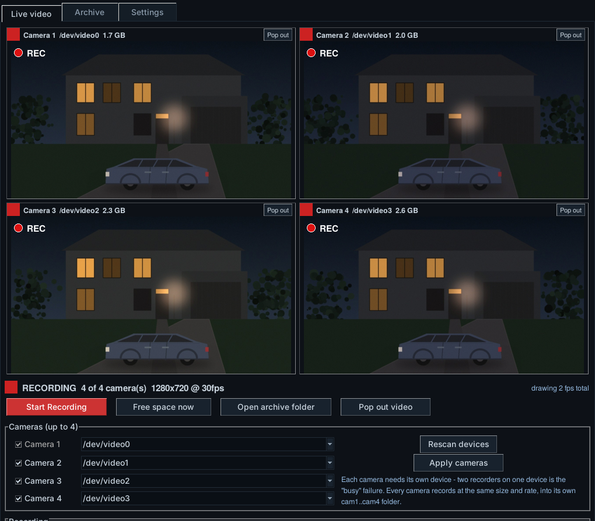
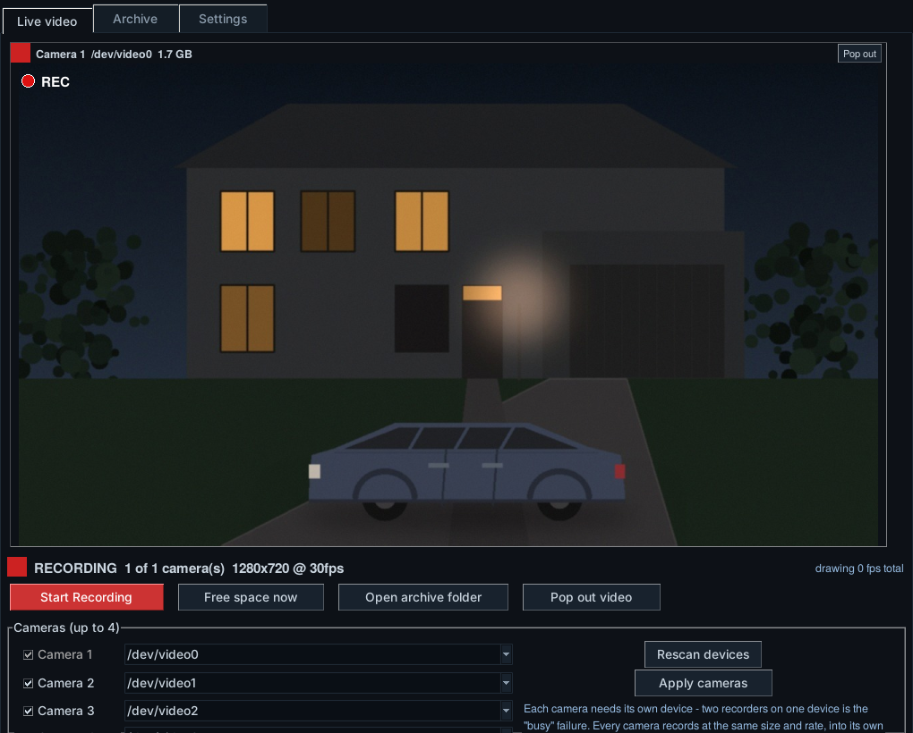
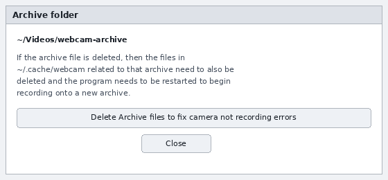
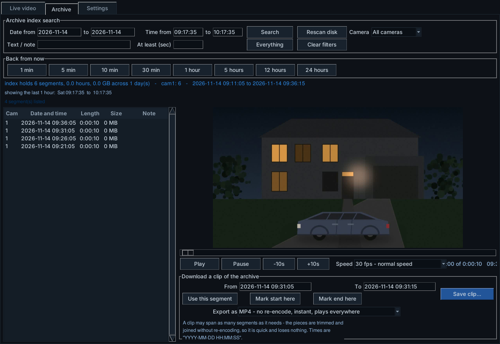
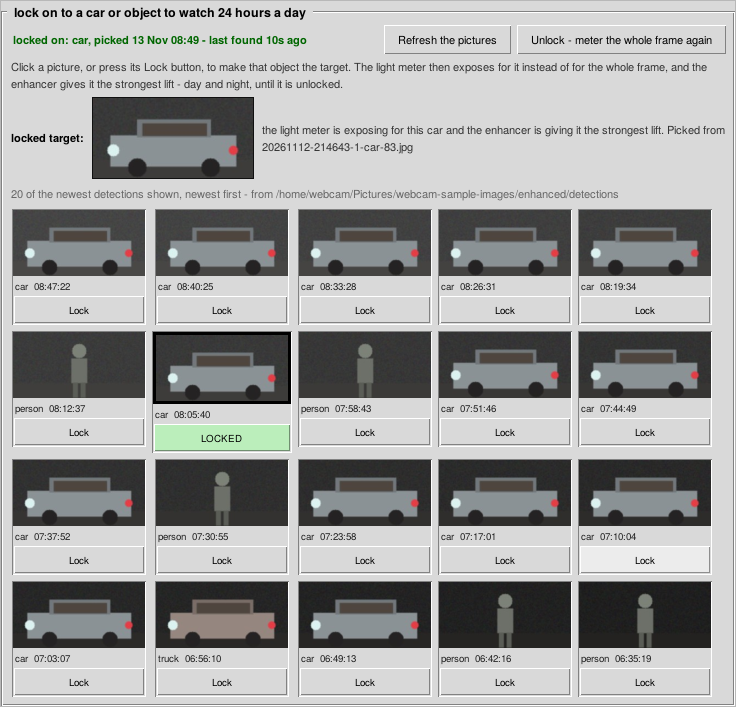

# Webcam Recorder and Light Adjuster (Python 3)

A security recorder and an automatic light adjuster for outdoor USB webcams on
Ubuntu 24.04 and 26.04, in one program.

It keeps the video: up to four cameras at 1280x720 and 30 frames a second,
cut into segments, indexed, searchable, and looped so the disk never fills. It
also does what this repository has always done - switches the camera between
tuned presets on today's real sunrise and sunset, corrects whichever preset is
in force by measuring the picture the camera is actually producing, and
corrects the picture itself at night with CLAHE and a machine-learning model
trained on your own camera.



```
python3 webcam_gui.py
```

That is the whole start-up. It opens recording.

> **About the figures.** The three window pictures in this README are layout
> diagrams rather than photographs - they are drawn, not captured, and the
> pictures inside the camera panes are placeholders. The older photographs
> further down (night correction, car and person detection, the status tile,
> the lock panel, the settings page) are real screenshots from a running
> installation. See [Replacing the diagrams](#replacing-the-diagrams-with-real-screenshots).

## Contents

- [What it does](#what-it-does)
- [Only one program can hold a camera](#only-one-program-can-hold-a-camera)
- [Install](#install)
- [The live video page](#the-live-video-page)
- [Recording](#recording)
- [The loop: how the disk is kept](#the-loop-how-the-disk-is-kept)
- [Several cameras](#several-cameras)
- [The archive page](#the-archive-page)
- [Searching](#searching)
- [Playback, slow motion and fast forward](#playback-slow-motion-and-fast-forward)
- [Cutting a clip out](#cutting-a-clip-out)
- [The settings page](#the-settings-page)
- [The schedule and the presets](#the-schedule-and-the-presets)
- [Automatic light adjustment](#automatic-light-adjustment)
- [Night image correction: CLAHE and brain G](#night-image-correction-clahe-and-brain-g)
- [Finding cars and people](#finding-cars-and-people)
- [Locking on to one target](#locking-on-to-one-target)
- [Is it working: the status tile](#is-it-working-the-status-tile)
- [Running it headless](#running-it-headless)
- [Where everything is written](#where-everything-is-written)
- [The files in this repository](#the-files-in-this-repository)
- [Troubleshooting](#troubleshooting)

## What it does

| | |
|---|---|
| **Records** | 1 to 4 cameras, 1280x720 at 30fps, the camera's own MJPEG in mp4 with no re-encoding, five-minute segments |
| **Loops** | recycles the oldest footage at 50, 100 or 250 GB, keeping 25 GB free |
| **Indexes** | every segment, searchable by date, time of day, camera, length or note |
| **Plays back** | 5fps slow motion through 30fps normal to 2 minutes a second |
| **Exports** | clips by wall-clock time, spanning segments, as MP4, MKV or AVI |
| **Adjusts** | the camera's own controls, on sunrise and sunset, all day and night |
| **Corrects** | the picture with CLAHE and a model trained on your own camera |
| **Detects** | cars and people, and can lock on to one of them |

## Only one program can hold a camera

This is the one thing that will bite, so it is first.

A USB camera can be streamed by exactly one program at a time. While this
program is recording, nothing else may be capturing those devices. If another
capture program has the camera, ffmpeg cannot open it, the pane stays dark,
and the line under it says:

```
Device or resource busy  <- another program is holding this camera; close it,
or pick a different device
```

Camera *controls* are a different matter and keep working throughout:
`v4l2-ctl` sets controls on a device that is being streamed, so every preset
and every automatic light adjustment still reaches the picture mid-recording.

## Install

Nothing to install by hand. Both entry points bootstrap themselves on first
run: they check for what they need, name what is missing, name the package
that provides it, and install it with your say-so, streaming the install as it
runs.

What they check for: `python3-tk`, `v4l-utils`, `ffmpeg`, ImageMagick, numpy,
OpenCV, TensorFlow and astral. `ffmpeg` is the one recording cannot do
without, so a start on a machine that has no ffmpeg offers to install it
there and then rather than printing a command to paste. It comes from apt,
not pip - the thing on PyPI called `ffmpeg` is an unrelated wrapper, not the
encoder.

```
git clone https://github.com/CodeProSpecialist/Webcam-Light-Adjuster-in-Python-3.git
cd Webcam-Light-Adjuster-in-Python-3
python3 webcam_gui.py
```

Two environment variables turn the bootstrap down: `WEBCAM_QUIET_INSTALL=1`
reports failures only, `WEBCAM_NO_BOOTSTRAP=1` skips the check entirely.

## The live video page

The page opens **recording**, on every enabled camera.

That is deliberate. A security recorder that waits to be told to record has
already missed whatever happened while it waited. The loop cap is what makes
it safe to do unattended: recording from the moment it opens can only ever use
the archive's own cap, and the oldest footage is recycled rather than the disk
filling up. There is no preview-only or stop button on this page: a security
recorder that can be switched off from its own front page is one that gets
switched off and left that way.

Each pane carries a red dot and **REC** in its top left corner while that
camera is recording - the convention every camera has used for forty years,
and the one piece of state worth reading from across a room. The mark needs
two things at once to appear: the recorder running *and* frames actually
arriving. A dark pane with a red dot on it can never happen, which would be
the most misleading thing this window could do.

The pane header carries the camera's device and how much that camera is
holding. Below the grid: how many cameras are live, the size and rate, and the
disk line.

With one camera it is a one-camera window - the grid only ever builds as many
panes as there are cameras, and the window sizes itself to them:



Two cameras sit side by side; three or four fill the quarters. The panes get
smaller as they get more numerous, because four 720p previews redrawn ten
times a second is real work - the archive keeps the full 1280x720 either way.

## Recording

Each camera gets one ffmpeg of its own, with one input and three outputs:

1. **the archive** - the camera's own frames in mp4, cut into five-minute
   segments, each named for the moment it starts
   (`2026-11-13_21-35-00.mp4`),
2. **a still a minute** into `~/Pictures/webcam-sample-images`, which is what
   the light meter, the enhancer and the brain read and train from,
3. **a small preview frame four times a second**, which is what the pane
   draws.

One ffmpeg with three outputs off one input gives all three without ever
opening a camera twice. That is the whole design: one process holds each
camera and everything else reads what it publishes, so the preview, the stills
the brain trains on, and the recording never fight over a device.

Segment names are why searching is cheap. The index reads a segment's start
time off its name without opening the file, so a date search across eight
thousand files costs nothing.

**Encoder.** `copy` is the default, and it is the whole reason this is cheap
to run. The camera already hands over compressed MJPEG frames, so they are
written to the file exactly as they arrive and nothing is encoded at all.
This is the same trick Xeoma calls *direct saving to the archive*: do not
decode and re-encode a stream that is already compressed. It costs almost no
CPU and about four times the disk.

`h264` is the other choice: it re-encodes to roughly a quarter of the disk,
and spends about a core per camera to do it. Pick it when disk is tighter
than CPU. A camera that only offers raw YUYV cannot be copied - there is
nothing compressed to keep - so it is encoded whatever the setting says, with
the fastest preset.

An existing settings file from before this default changed is brought
forward once, so a recorder that was quietly spending a core on h264 stops
doing so. Pick `h264` yourself afterwards and that choice sticks.

**The preview is the other half of it.** The live panes are fed by their own
output at 4 frames a second, scaled to 640 wide before the frame is encoded.
Xeoma does this with a camera's second, lower-resolution stream; a USB camera
only has one stream, so the frames are thinned and shrunk instead. On a copy
archive this preview branch is the only real work the process does, which is
why it is deliberately small. Both are settings: raise `preview_fps` for a
smoother window at a higher cost.

**Rough sizes.** On the `copy` default, expect roughly 6 to 9 GB an hour per
camera at 720p30 - MJPEG compresses each frame on its own and cannot lean on
the one before it. On `h264` at CRF 23 it is nearer 1.5 to 2.5 GB an hour,
depending on how much the scene moves; a still driveway at night compresses
much harder than daytime with traffic.

| Loop cap | One camera | Two cameras | Four cameras |
|---|---|---|---|
| 50 GB | about 7 hours | about 3 hours | about 1.5 hours |
| 100 GB | about 13 hours | about 7 hours | about 3 hours |
| 250 GB | about 1.5 days | about 16 hours | about 8 hours |

Those are `copy` hours. On `h264`, multiply by about four. Either way the
loop cap is what holds it: the archive never grows past the cap, it just
holds fewer hours.

## The loop: how the disk is kept

Two limits hold the archive, and a janitor runs once a minute deleting
oldest-first until both are satisfied:

- **the loop cap** - 250 GB by default, or 100 or 50. This is what makes it a
  loop recorder: once full, the oldest hour goes to make room for the newest.
- **a free-space floor** - 25 GB by default, left free on the filesystem, so a
  disk shared with everything else never fills up.

Two things are never deleted: the segment currently being written, because
ffmpeg is still writing it, and anything outside the archive folder - exported
clips live in their own folder precisely so the loop cannot reach them.

With several cameras there is still only one janitor, because the cap is a
limit on one disk and four janitors deciding independently what to delete off
one disk would race each other. The oldest segment anywhere across all cameras
is the one that goes.

The disk line says where it stands:

```
archive 41.2 of 250 GB (16% of the loop) in 8,642 segments   -   96.4 GB free
on disk, floor 25 GB   -   oldest kept: 2026-11-07_04-15-00.mp4
```

## Deleting an archive by hand

The archive folder and `~/.cache/webcam` have to agree with each other.
`~/.cache/webcam` holds the recorder's pid file, its status files and the
preview frames, and those still name segments that the archive folder used to
hold. Delete an archive yourself - in a file manager, or with `rm` - and the
recorder carries on writing against state that no longer matches the disk,
which shows up as a camera that simply will not record.

**Open archive folder** therefore opens the folder and then says so in a
window of its own:

> If the archive file is deleted, then the files in `~/.cache/webcam` related
> to that archive need to also be deleted and the program needs to be
> restarted to begin recording onto a new archive.



Under that notice is the repair:

- **Delete Archive files to fix camera not recording errors** - stops
  recording, empties `~/.cache/webcam`, and asks you to restart the program.
  No recorded video is touched: everything it deletes is the pid file, the
  status files and the preview frames, all of which are written again on the
  next start. After the restart the recorder begins a new archive.

It asks for confirmation first, and reports anything it could not delete.

## Several cameras

Four slots, each a tick and a device picker. Four is the ceiling on purpose:
four cameras on one USB controller is about where the bandwidth runs out,
and on `h264` four encodes at 720p30 is a real load on a CPU.

- **Each camera needs its own device.** Two recorders on one device is the
  "busy" failure, so a duplicate is dropped rather than accepted.
- **Camera 1 cannot be switched off.** It is what every preset, the light
  meter and the brain mean by "the camera".
- **Only camera 1 feeds the brain.** The model is trained on one camera's view
  of one scene; mixing four views into one corpus would teach it the average
  of four scenes, which corrects none of them. Cameras 2 to 4 still write
  their own stills, in `webcam-sample-images/cam2` and so on.

A single camera writes into the archive root, exactly where it always did. Add
a second and everything moves into `cam1`..`cam4` folders, with the index
treating loose files in the root as camera 1 - so an archive recorded before
this existed still plays.

## The archive page



Every segment goes into a small SQLite index once - start time from its name,
duration from one ffprobe, size from the filesystem - and searches run against
that. Re-scanning is cheap: a segment already indexed is skipped unless its
size has changed. Segments the janitor has recycled drop out.

A month of five-minute segments is eight thousand files. Answering "what was
on camera last Tuesday between 9 and 11 at night" by walking eight thousand
files and ffprobing each one takes long enough to feel broken, which is what
the index is for.

## Searching

**Back from now**, one click: 1 min, 5 min, 10 min, 30 min, 1 hour, 5 hours,
12 hours, 24 hours. Each fills the date and time boxes as well as searching,
so the span can then be nudged by hand. This is how an archive actually gets
searched - something happened, and it happened recently.

These filter on real start and end times rather than on the date and
time-of-day columns, because a span of hours crosses midnight and a
time-of-day filter cannot express "the last five hours" across one. A segment
counts if any part of it falls in the span, so the segment being written when
the thing happened is included rather than missed by seconds.

**By hand:** a date range, a time-of-day range, a camera, a minimum length,
and free text matched against the file name and your own note. The date range
and the time-of-day range are separate on purpose, because the question is
usually "between nine and eleven at night, across the last week" rather than
one continuous span. A time-of-day range that wraps midnight (22:00 to 02:00)
is handled as the two pieces it really is.

## Playback, slow motion and fast forward

Playback is its own capture on the file, so an archive can be watched while
the recorder keeps recording.

| Speed | What it means |
|---|---|
| 5 fps | six times slow motion - the speed to watch somebody's hands at |
| 10 fps | three times slow motion |
| 15 fps | half speed |
| 20 fps | two thirds speed |
| **30 fps** | **normal speed - the default** |
| Fast forward, 1 min/sec | an hour of a still driveway in a minute |
| Fast forward, 2 min/sec | twice that again |

The slow end reads as frames per second: a 30fps recording drawn at 5 frames a
second is six times slow motion. The fast end reads as minutes per second, and
is the speed to find the one moment something moved at.

Past normal speed the frames have to be skipped rather than drawn - a minute
of footage a second is 1800 frames a second, which no screen draws and no eye
reads - so every Nth frame is taken instead, which is exactly what fast
forward looks like on anything else.

Changing speed mid-play keeps the position: the playhead stays where it is and
only the rate it moves at changes, which is what makes slowing down at the
interesting moment useful. The seek bar, **-10s** and **+10s** work at any
speed, and the position line shows both the offset into the segment and the
real clock time that frame was recorded at.

## Cutting a clip out

A clip is cut by absolute wall-clock time, not by file, because the bit you
want almost never lines up with the segment boundaries and usually spans two
or three of them. The index finds every segment of that camera overlapping the
span, each is trimmed to its overlapping part, and the pieces are joined into
one video.

**Use this segment** fills the times from the selected segment; **Mark start
here** and **Mark end here** take them from the playhead, so a clip can be
marked while watching.

| Export | What you get |
|---|---|
| **MP4** - no re-encode | the default. A second to write whatever the length, loses nothing, plays everywhere |
| **MP4** - re-encoded | starts on the exact frame asked for, costs roughly real time to write |
| **MKV** - no re-encode | survives a damaged segment better |
| **AVI** - no re-encode | for older players |

A copy can only start on a keyframe, so a copied clip can open up to two
seconds before the time asked for - with the recorder's two-second keyframe
spacing, never more than that. Re-encode when the exact moment matters, or
when a copied clip opened on a frozen picture.

A clip comes from one camera: joining two cameras' segments by time would cut
between views every few minutes, which is not footage anybody can watch. The
camera is taken from the selected segment and written into the name:
`clip-cam1-20261113-130200-to-130830.mp4`.

Clips are written to `~/Videos/webcam-clips`, outside the archive, where the
loop cannot recycle them.

## The settings page

The window that used to be the whole program, unchanged, as a page of this
one: every control the camera reports, the presets, the light meter, the
brain's tile, the status tile and the lock panel, on one tall scrolling page.


It is built the first time the tab is opened rather than at start-up, because
it reads every control off the camera, probes the brain and starts the
scheduler's terminal - a second or two that should not sit in front of the
video.

`python3 webcam_settings_page.py` still opens it on its own, exactly as it
did when it was the whole program.

## The schedule and the presets

`python3-sunrise-sunset.py` runs in the terminal along the settings page and
switches presets on today's real sunrise and sunset for where the camera is,
so the window shows what the schedule is doing and not only what has been
pressed in it.

Six presets, plus defaults: **Night**, **Night Mono**, **Golden AM**, **Day**,
**Bright Sun**, **Golden PM**. Colour is kept 24 hours a day, with a little
less of it at night.

Each is also a standalone script, for cron or for trying one by hand:

```
python3 night-sharp-webcam.py
python3 day-sharp-webcam.py
python3 bright-sun-sharp-webcam.py
```

Everything goes through `webcam_presets.py`, which clamps each value to what
the camera reported it can take - a value past the end of a control's range is
refused by the driver rather than clamped by it, and silently refused at that.

## Automatic light adjustment

On top of the presets, `webcam_light_meter.py` measures the picture the camera
is actually producing, from the stills in the snapshot folder, and nudges the
controls to improve it - enhancing the preset rather than replacing it.

What it will and will not do:

- it leaves the preset's colour saturation and hue alone,
- it never raises gamma above the preset,
- it keeps sharpness in the 50 to 100% band - more by day, less at night,
  where sharpening mostly amplifies grain,
- it stays near the preset's focus unless the picture is actually blurry,
- auto exposure stays on aperture priority and dynamic framerate stays on.

Every adjustment is logged with the camera's own values either side, and the
log records what the camera *says* rather than what it was told: `v4l2-ctl`
reports success for a write the camera then ignores, so each control is read
back.

## Night image correction: CLAHE and brain G


Two switches in the settings page, independent of each other:

- **night image CLAHE and ML auto correct**
- **24 hour image CLAHE and ML auto correct**

OpenCV does the foundational, rule-based half - reading the frames, CLAHE,
filters. TensorFlow does the learnt half.


### Brain G

Brain G is the model that corrects the picture. It follows the same training
pattern as the trading robots in the neighbouring repositories: a frozen,
read-only foundation pretrained 20,000 times on clear photographs, and a
learnt layer on top of that.

**It trains itself on your camera and deletes the brain that shipped here.**
The shipped brain is a starting point and nothing more. Once the model can
retrain from your own pictures it does, across every camera light change
through a full day and night so that every preset and every light condition is
covered - and the shipped brain is deleted, so what is running is the one
trained on your scene.

When the correction looks wrong there is a button for it, labelled plainly:
*"If image is corrected too dark or incorrectly, delete and retrain the
machine learning model."*

`train_webcam_brain.py` does the pretraining, from a folder of clear photos:

```
python3 train_webcam_brain.py --photos ~/Pictures/clear-photos
python3 train_webcam_brain.py --photos ~/Pictures/clear-photos --force
```

## Finding cars and people


`webcam_detect.py` uses OpenCV object detection to find cars, other vehicles
and people, and the enhancement uses what it finds to improve those parts of
the picture - in the dark especially, where a whole-frame correction spends
its effort on an empty driveway.

## Locking on to one target



Below the before-and-after frames sit the twenty most recent detections as
thumbnails. Click one, or use the lock-select button, and that target is
watched 24 hours a day and its image quality is what the correction optimises
for. `webcam_lock.py` holds the lock, finds the target again between frames,
and the panel says what it is holding on to.

## Is it working: the status tile


The status tile answers the question the rest of the window only implies: is
the camera taking what this program sends, and is the picture it produces
usable? It reads every control back, measures the newest still, and shows four
frames - before and after, twice - so a correction can be judged rather than
trusted.

`webcam_verify.py` does the checking, and **Check camera** runs it on demand.

Every error, from every part of the program, is also written to one log with a
timestamp, so a failure at three in the morning can be read back in the
morning rather than having scrolled past.

## Running it headless

Both halves work without the window, for cron and for systemd:

```
python3 webcam_record.py              # record every enabled camera
python3 webcam_record.py preview      # live preview only, nothing kept
python3 webcam_record.py status       # what is running, what is on disk
python3 webcam_record.py devices      # every camera node that can be taped
python3 webcam_record.py janitor      # recycle the oldest once, then exit

python3 webcam_archive.py scan        # bring the index up to date
python3 webcam_archive.py stats
python3 webcam_archive.py search --date 2026-11-12 --from 21:00 --to 23:00
python3 webcam_archive.py search --camera 2 --min-seconds 60
python3 webcam_archive.py clip "2026-11-12 21:35:00" "2026-11-12 21:41:30" \
    --camera 1 --format mp4
```

A systemd user unit for recording at boot:

```ini
[Unit]
Description=Webcam recorder
After=graphical-session.target

[Service]
ExecStart=/usr/bin/python3 %h/Webcam-Light-Adjuster-in-Python-3/webcam_record.py
Restart=always

[Install]
WantedBy=default.target
```

`systemctl --user enable --now webcam-record`. Stop it with systemd rather
than killing it: ffmpeg finishes the mp4 it is writing when asked politely,
where a kill leaves the last segment with no moov atom and it will not play.

## Where everything is written

| Path | What |
|---|---|
| `~/Videos/webcam-archive/` | the segments (in `cam1`..`cam4` with several cameras) |
| `~/Videos/webcam-clips/` | exported clips - outside the loop's reach |
| `~/Pictures/webcam-sample-images/` | the stills the meter and the brain read |
| `~/.config/webcam/recorder.conf` | recorder settings |
| `~/.config/webcam/archive.db` | the segment index |
| `~/.cache/webcam/preview-cam1.jpg` | the frame each pane draws |
| `~/.cache/webcam/` | recorder pid, status and preview files - safe to delete when the program is stopped |

No user name is written into any of these: they resolve for whoever is running
the program, which is what makes this work the same from a terminal, from cron
and from a systemd unit. `WEBCAM_ARCHIVE`, `WEBCAM_CLIPS`, `WEBCAM_SNAPSHOTS`
and `WEBCAM_DEVICE` override them.

## The files in this repository

| File | What it is |
|---|---|
| `webcam_gui.py` | the main window: live video, archive, settings |
| `webcam_record.py` | the recorder, the janitor, and the headless CLI |
| `webcam_archive.py` | the segment index, searching, and clip export |
| `webcam_settings_page.py` | the settings page, and still a program on its own |
| `webcam_presets.py` | the preset engine, with every value clamped |
| `webcam_light_meter.py` | measuring the picture and adjusting the camera |
| `webcam_enhance.py` | CLAHE and brain G, and the two switches |
| `train_webcam_brain.py` | pretraining the foundation |
| `webcam_detect.py` | cars and people |
| `webcam_lock.py` | locking on to one of them |
| `webcam_status.py` | the status tile |
| `webcam_verify.py` | does the camera take what it is sent |
| `webcam_errors.py` | one error log, timestamped |
| `webcam_led.py` | turning the camera's LED off |
| `webcam_location.py`, `webcam_time.py` | where it is, and what time it is there |
| `webcam_bootstrap.py`, `webcam_install.py` | installing its own dependencies |
| `python3-sunrise-sunset.py` | the schedule |
| `*-sharp-webcam.py` | one preset each, for cron or by hand |

## Troubleshooting

**A pane is dark and says the device is busy.** Another program is capturing
that camera. Close it, or pick a different device.

**A pane says "camera lost - retrying in 12s".** The USB camera was unplugged
or re-enumerated by the kernel. The recorder restarts it with a backoff; a
recorder that stays down until somebody notices is not a recorder.

**The last segment will not play.** It was being written when the program was
killed outright, so it has no moov atom. Close the window, or stop it with
Ctrl-C or `systemctl --user stop`, all of which ask ffmpeg politely.

**Fast forward runs at normal speed.** The ffmpeg in use is too old to read
faster than real time. Ubuntu 24.04 and 26.04 both ship a new enough one.

**A search finds nothing you can see on disk.** Press **Rescan disk** - the
index has not caught up with what the recorder has written.

**The camera will not record after an archive was deleted by hand.** The
recorder's state in `~/.cache/webcam` still names segments that no longer
exist. Press **Open archive folder**, then **Delete Archive files to fix
camera not recording errors**, and restart the program.

**Recording is using too much CPU.** Check the **Video** setting on the live
page. `copy` is the default and costs almost nothing; `h264` spends about a
core per camera. If it is already on `copy` and the load is still high, the
camera is probably raw-only, so its frames have to be encoded - and the
preview is doing the rest, which `preview_fps` turns down.

**The night correction is too dark.** Use the delete-and-retrain button in the
settings page. The model is trained on your scene; if it learned the wrong
thing from a bad stretch of pictures, retraining from scratch is the fix.

## Replacing the diagrams with real screenshots

The three window figures are diagrams, drawn to show the layout. To replace
them with real screenshots from your own installation, take these and
overwrite the files:

| File | What to capture |
|---|---|
| `docs/live-video-page.png` | the Live video page with several cameras recording |
| `docs/one-camera-live.png` | the Live video page with one camera |
| `docs/archive-page.png` | the Archive page, mid-playback, with results listed |
| `docs/archive-notice.png` | the notice window that **Open archive folder** opens |

No markdown needs changing - the README references those paths already.
